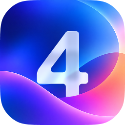

<div align="center">



# Altrone UI

A modern React component library with a built-in design system —<br />
light &amp; dark themes, glass surfaces, concentric radii and motion that respects your users.

[](https://www.npmjs.com/package/altrone-ui)


[](./LICENSE)

**[Documentation](https://altrone.vercel.app/)** ·
**[Installation](https://altrone.vercel.app/en/installation)** ·
**[MCP](https://altrone.vercel.app/en/foundations/mcp)**

</div>

---

## Why Altrone

- **50+ components** — controls, forms, overlays, navigation, data tables, feedback and layout primitives, all designed to work together.
- **Real design system** — semantic tokens for color, spacing, radius, typography, elevation and motion instead of one-off values.
- **Light & Dark + 10 accents** — all components work seamlessly with light and dark themes and adapt to the selected accent color.
- **Application shell** — `Application` and `Screen` give you sidebar, header, aside and bottom navigation that adapt across breakpoints.
- **Accessible** — keyboard navigation, focus management in overlays, `prefers-reduced-motion` support.
- **SSR-friendly** — no `window` / `document` access during render.
- **Typed** — written in strict TypeScript; every prop is documented and auto-completed.
- **Localized** — built-in dictionaries for English, Russian, French, German, Spanish, Chinese, Portuguese and Turkish.
- **Composable** — every component forwards its `ref`, and `asChild` lets you swap the root element for a router `<Link>` or your own markup.

## Installation

```bash
npm install altrone-ui
```

Altrone UI requires **React 19** or newer.

## Quick start

Import the stylesheet once, then wrap your app in `Application`:

```tsx
import { Application, Button, Flex, Text } from 'altrone-ui';
import 'altrone-ui/style.css';

export default function App() {
  return (
    <Application theme="auto" accent="blue" language="en">
      <Flex orientation="vertical" gap="m" align="start">
        <Text size={6} weight="bold">
          Hello, Altrone
        </Text>
        <Button
          label="Get started"
          variant="submit"
          onClick={() => console.log('Hi!')}
        />
      </Flex>
    </Application>
  );
}
```

`Application` provides theming, localization, icons, dialogs and notifications to everything inside it.

## Components

| Category       | Components                                                                                                                                                                  |
| -------------- | --------------------------------------------------------------------------------------------------------------------------------------------------------------------------- |
| **Layout**     | Application, Screen, Box, Grid, Flex, Splitter, Scrollable, Toolbar, Spoiler, CollapsedList, Divider                                                                        |
| **Overlays**   | Modal, Dialog, Drawer, Popover, Dropdown, Tooltip                                                                                                                           |
| **Controls**   | Button, Form, Label, TextInput, PasswordInput, NumberInput, TextArea, AutocompleteInput, Search, Select, Checkbox, Switch, Radio, Slider, DatePicker, ColorPicker, FilePicker |
| **Content**    | Text, Image, Avatar, DataTable, Tags, Calendar                                                                                                                              |
| **Feedback**   | Notifications, Message, Loading, Skeleton, Progress, Result                                                                                                                 |
| **Navigation** | Tabs, NavigationList, SideNavigation, BottomNavigation, Breadcrumbs, Pagination                                                                                             |

Browse live examples and full API docs in the [documentation](https://altrone.vercel.app/).

## Examples

The Storybook ships complete, realistic apps built only from Altrone components — a mail client, a kanban board, a music app, a streaming title page, a helpdesk, a catalog and more. Run `npm run storybook` and open **Applications**.

## Theming

Everything is driven by CSS custom properties, so overriding a token overrides it everywhere:

```tsx
<Application theme="dark" accent="teal">
  …
</Application>
```

Switch the theme at runtime with `useAltroneTheme()`. Dark mode is toggled through the `data-altrone-theme` attribute, and `getThemeInitScript` prevents a flash of the wrong theme on first paint.

## Altrone MCP

Using an AI assistant? [`@altrone/mcp`](https://altrone.vercel.app/en/foundations/mcp) exposes the component documentation to MCP clients, so your assistant can look up props and usage instead of guessing.

## License

[MIT](./LICENSE) © Alexander Perevezentsev
